# Visual pass — before / after (2026-10-16)

A consistency pass over the web UI and the notch's web layer. No behaviour changed: same screens, same flows, same
copy. Every screenshot was taken by the repo's own scripts (`scripts/redesign-shots.mjs`, `scripts/notch-shots.mjs`,
`scripts/shots.mjs`) plus one extra light-mode pass, against an isolated demo gateway (`SHUACREW_DEMO=1` on :7421, a
throwaway home, fresh data per side), so the live gateway and your sessions were never touched. Images are WebP at 1×.

## What changed

| | Before | After |
|---|---|---|
| Low-contrast text (WCAG AA, 21 routes × dark + light) | **1,332** instances | **0** |
| Easing curves in CSS | 90 `cubic-bezier()` uses, 25 different curves | the notch's two springs (`--spring`, `--ease-out`); 4 symmetric loop/exit curves kept |
| `motion` springs in TSX | 24 springs, 17 different stiffness/damping pairs | `SPRING` / `SPRING_TUCK`, the notch's own physics |
| Today's stats strip | collapsed to 0 px (labels only) | values visible |
| A long Shua / agent turn | "Thinking…" forever | "Thinking… 12s", then "Still working…" past 20 s |
| Page insets and titles | 16, 26 and 32 px insets; title weights 640 and 650 | one `--page-x` / `--page-top`, one `--title-weight` |
| Focus | every tab stop shows a ring (inputs through their container) | unchanged |

1. **One token layer** — [`apps/web/src/design-tokens.css`](../../../apps/web/src/design-tokens.css): motion, radii
   ends (xs/xl/pill), type scale, 4 px spacing, page insets, elevation names, one focus ring. Palettes keep colour;
   designs keep their s/m/l radii.
2. **Motion matches the notch.** `--spring` / `--ease-out` are the island's open and tuck springs
   (`ISLAND_OPEN`, `ISLAND_TUCK` in `lib/spring-easing.ts`) as CSS `linear()`; `SPRING` / `SPRING_TUCK` are the same
   springs as `motion` physics. `lib/design-tokens.test.ts` fails if the CSS and the notch ever drift apart.
3. **Contrast.** `--text-3` was 3.7:1 on raised surfaces in Onyx (the default dark palette): it's now 4.8:1, with
   matching fixes for Frost, Graphite, Carbon, Midnight, Porcelain and Paper. Porcelain's status colours (ok / bad /
   wait) were 3.7–4.2:1 as chip text and now clear AA. Accent used as text goes through `--accent-text`. The Shua
   panel's own `--text-3` went from 44 % to 56 % white.
4. **Never looks stuck.** `components/WorkingFor.tsx` (shared with the notch's `NotchThinking`) adds elapsed time to
   the session thread's "Thinking…" and to Shua's panel ("Reading your screen… 8s"); plain thinking turns into
   "Still working…" after 20 s, as the notch already did.
5. **Fixes:** Today's readouts row (a scroll grid squeezed its `overflow:hidden` row to nothing); the first-run setup
   card in a light theme (dim lead line, white step pill, dark-on-dark "Save & continue", wrapped step names); the
   notch's send button is round like the rest of the island's controls; Studio floor's title lines up with every
   other page.

## Before / after

<table>
<tr><th>Before</th><th>After</th></tr>
<tr><td colspan="2"><b>Today</b> — the stats strip was clipped to its labels</td></tr>
<tr><td>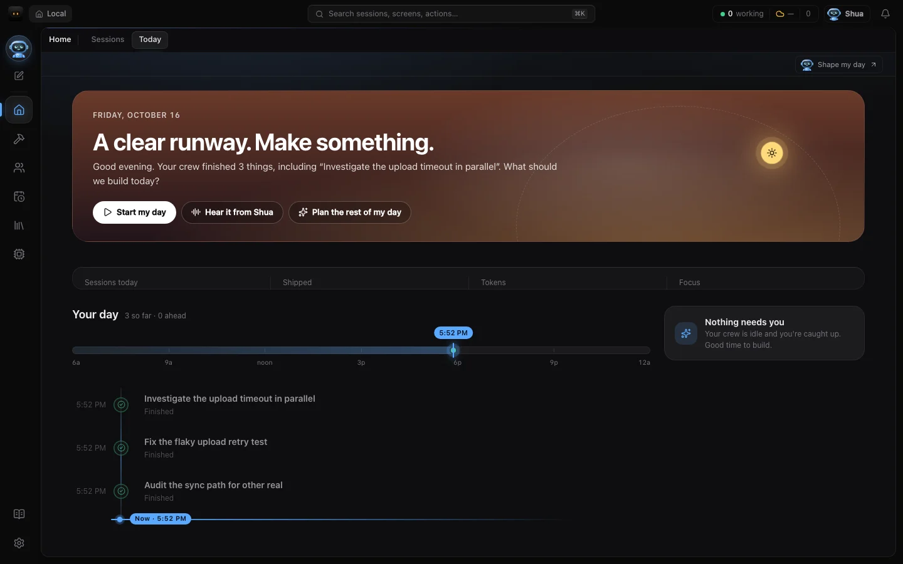</td><td>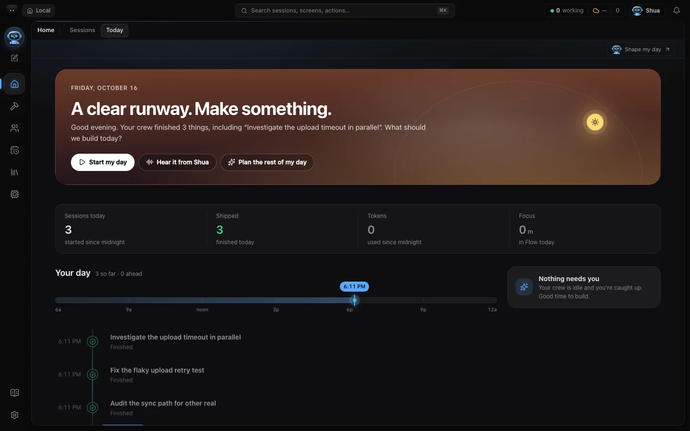</td></tr>
<tr><td colspan="2"><b>First-run setup, light theme</b></td></tr>
<tr><td>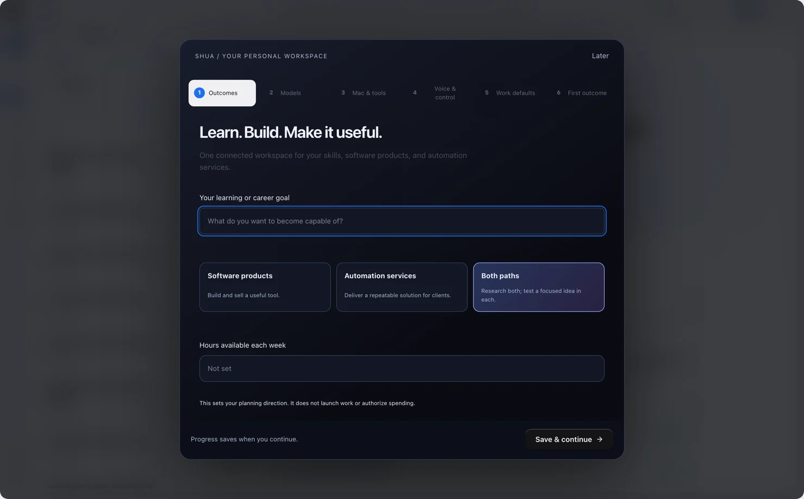</td><td>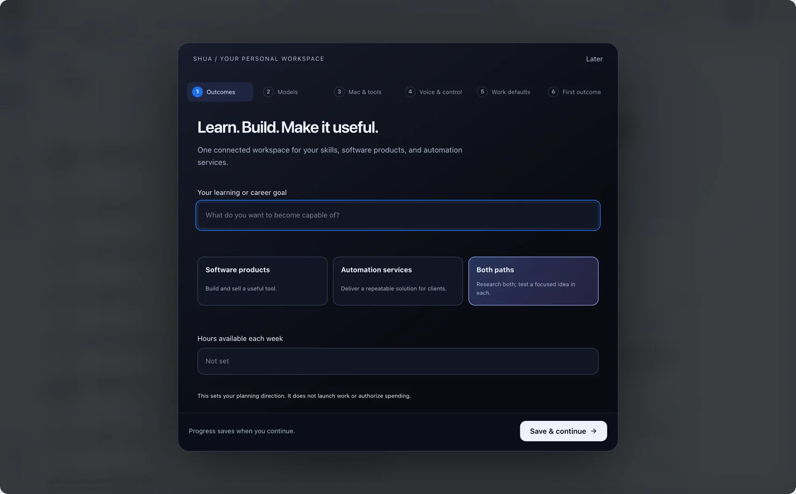</td></tr>
<tr><td colspan="2"><b>Notch, typing</b> — send is round</td></tr>
<tr><td>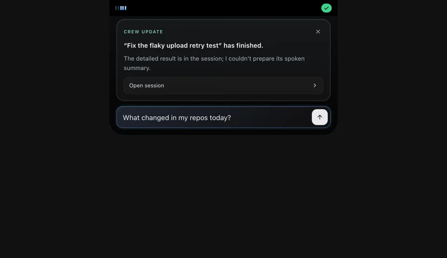</td><td>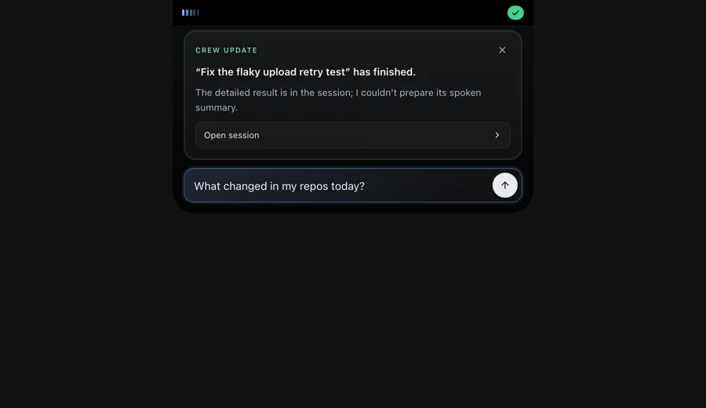</td></tr>
<tr><td colspan="2"><b>Studio floor</b> — title on the shared page inset; meta text readable</td></tr>
<tr><td>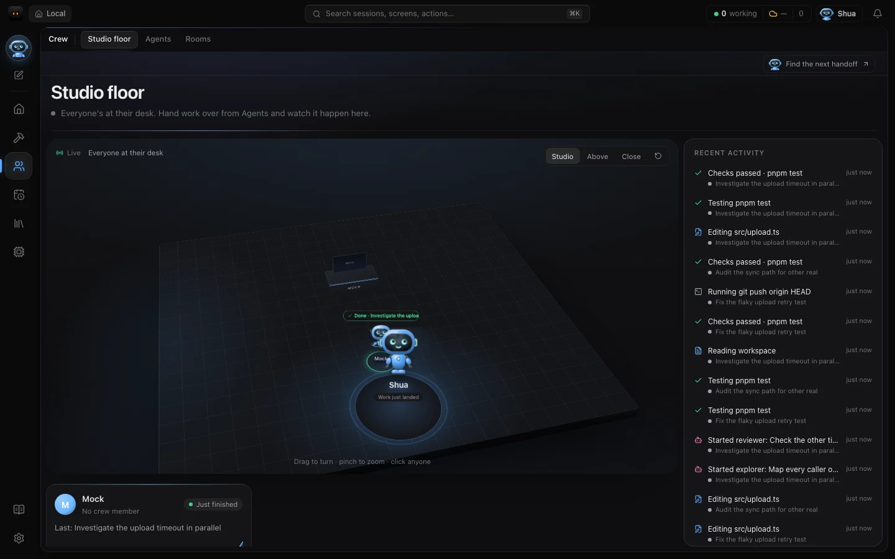</td><td></td></tr>
<tr><td colspan="2"><b>Board, light</b> — status chips clear AA</td></tr>
<tr><td>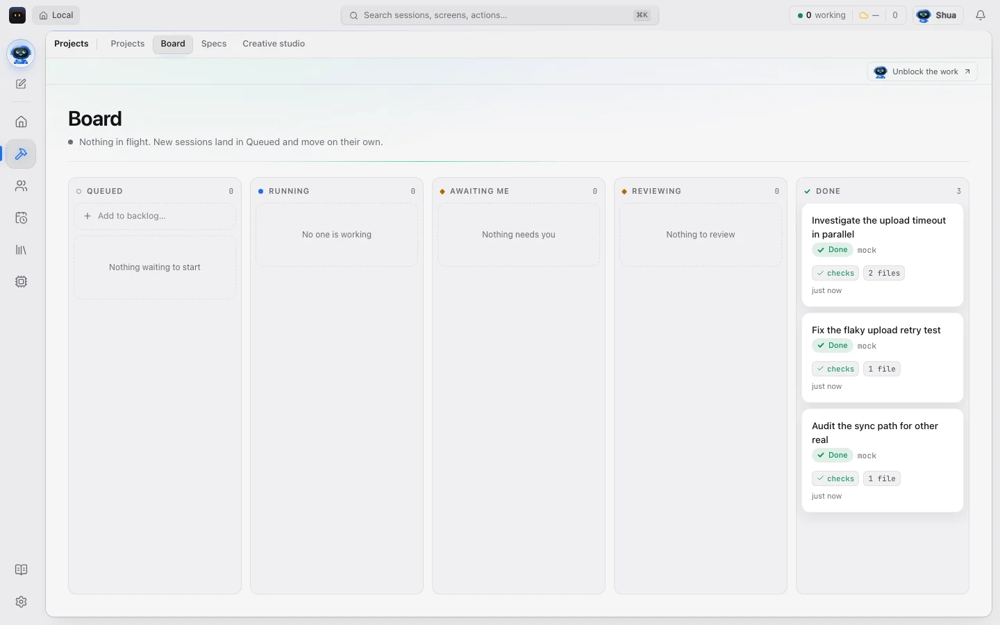</td><td>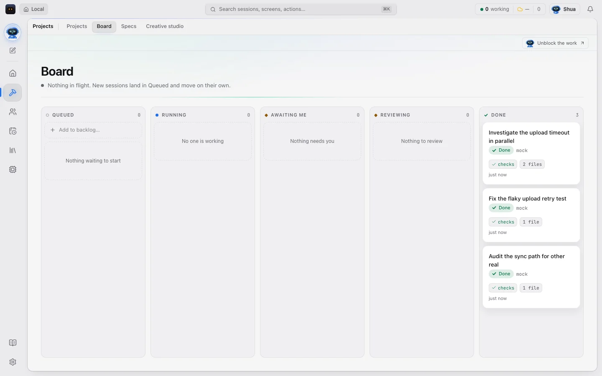</td></tr>
<tr><td colspan="2"><b>Developer, light</b> — event kinds and the primary button readable</td></tr>
<tr><td></td><td>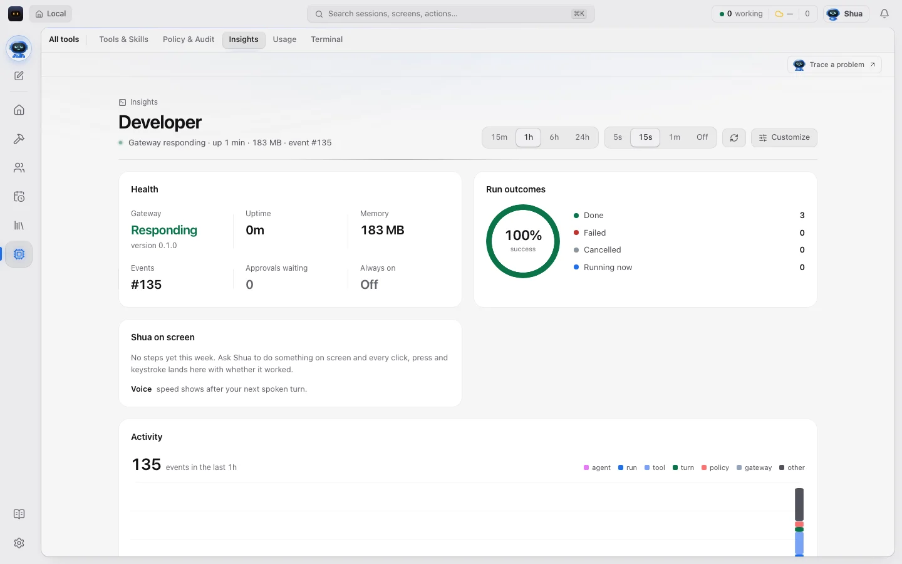</td></tr>
<tr><td colspan="2"><b>Sessions</b></td></tr>
<tr><td>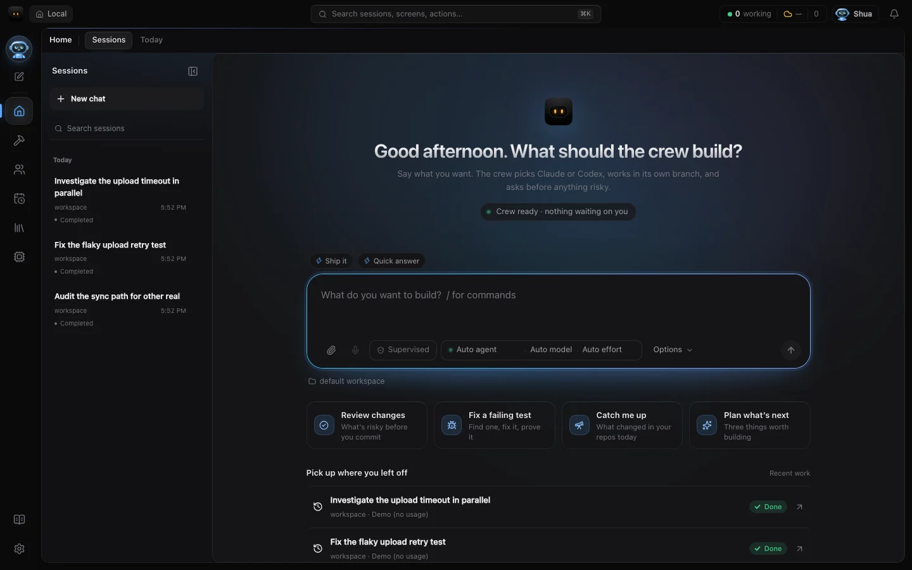</td><td>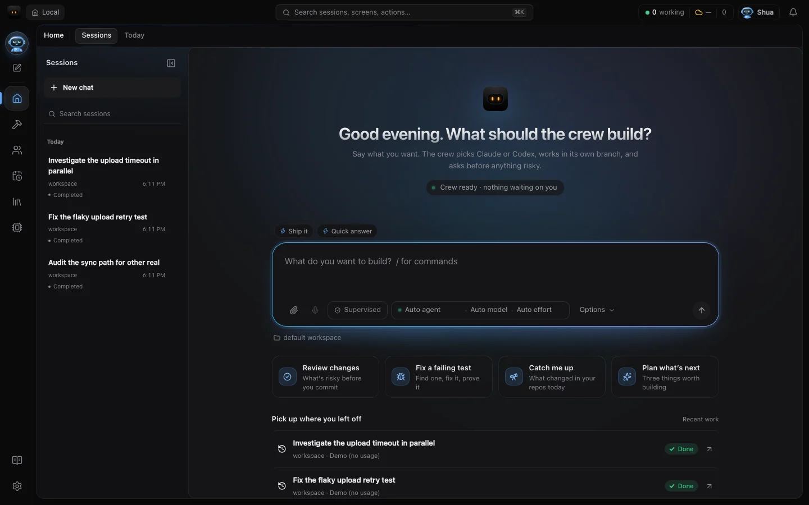</td></tr>
<tr><td colspan="2"><b>Settings</b></td></tr>
<tr><td>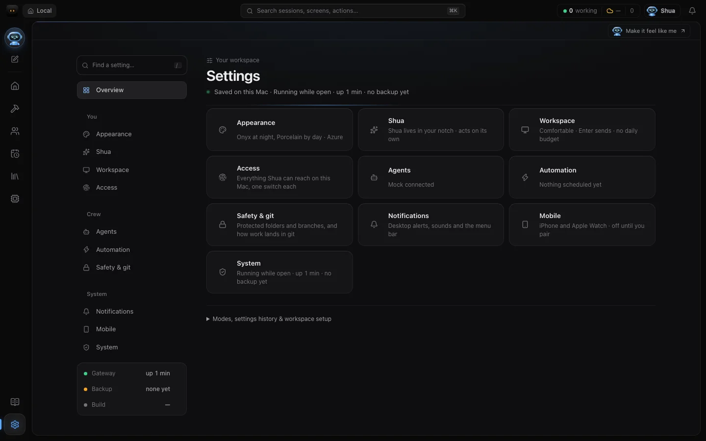</td><td>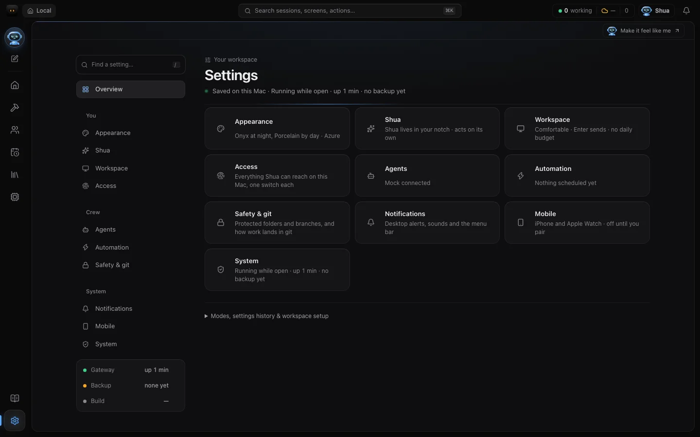</td></tr>
</table>

Every other pair is in [`before/`](before) and [`after/`](after) under the same name: `redesign-*` (sessions, today,
floor, board, library, settings, palette, notch rest/open), `notch-*` (rest, open, busy, typing, More), `shots-*`
(mission, board, palette, launch, narrow; dark and light), `extra-*` (light sessions, today, board, settings,
developer; dark developer, floor, usage).

## Not done here (worth a follow-up)

- **Adoption of the type and radius scales.** The tokens exist; 68 font sizes and 75 radii are still literal values
  across ~60 CSS files. Snapping them is a screen-by-screen job (layouts shift), best done as each screen is touched.
- **Label casing.** 58 rules still set small labels in spaced capitals ("RECENT ACTIVITY", "CREW UPDATE") while newer
  screens use sentence case. A product call, so left alone.
- **Setup card copy** still says "Learn. Build." and "Your learning or career goal" although Learn was removed.
- **Screenshot scripts:** `redesign-shots.mjs`'s `session.png` and `shots.mjs`'s `run-*.png` aren't produced (their
  `a[href^="/sessions/"]` / `a[href^="/runs/"]` selectors no longer match), and `shots.mjs`'s light pass only
  captures the first-run setup card (it doesn't snooze `shuacrew.setup.later`).
